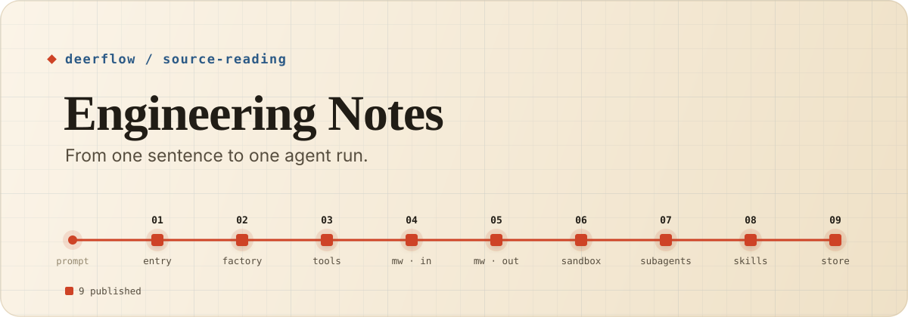

<p align="center">
  
</p>

<h1 align="center">DeerFlow Engineering Notes</h1>

<p align="center">
  Reading <a href="https://github.com/bytedance/deer-flow">DeerFlow</a>'s Python agent runtime through the path a request follows —
  from user input to a managed agent run.
</p>

---

This is a source-reading tutorial for DeerFlow's Python agent runtime. Instead
of touring folders one by one, it follows the main product path: a user request
is accepted by the Gateway, becomes a managed **run**, enters the lead-agent
graph, receives a tool surface, passes through middleware, executes tools in a
sandbox, delegates work to subagents, loads skills, and leaves recoverable
runtime records.

The goal is to make DeerFlow understandable as an engineering system. Every
article pairs a plain-language explanation with source anchors pinned to the
exact upstream commit it describes.

## Who this is for

These notes are for readers who want source-backed explanations of how an
industrial agent project is put together:

- You can read Python and want a guided path through the runtime.
- You want to understand run lifecycle, tools, middleware, sandboxing,
  subagents, skills, and persistence as one connected system.

This is not a replacement for the official repository. It is a map for reading it.
For the full picture — code, issues, roadmap, and actual development — go to:

> **→ [bytedance/deer-flow](https://github.com/bytedance/deer-flow)**

## Reading path

1. **Request entry** — how Gateway hosts user input as a managed run.
2. **Lead-agent factory** — how runtime config becomes a runnable agent graph.
3. **Tool assembly** — why registered tools are not automatically available to a run.
4. **Middleware pipeline I** — how DeerFlow prepares context before model calls.
5. **Middleware pipeline II** — how model output is adjudicated, gated, and cleaned up.
6. **Sandbox system** — where tools execute, and why local and container sandboxes are not the same boundary.
7. **Subagent system** — how complex subtasks are delegated to constrained full agents.
8. **Skill system** — how experience becomes installable, reviewable, reusable agent capability.
9. **Persistence, store, and checkpointer** — what can resume, what can be queried, and what can be audited.

Read in order. Later chapters assume the run, tool, middleware, and sandbox
boundaries introduced earlier.

## Source baseline

The current edition follows the **DeerFlow 2.2.0 development snapshot** checked
on **2026-10-27**, pinned to [`51d59a1c`](https://github.com/bytedance/deer-flow/commit/51d59a1cdff92626bd9f03f1b2254f34a824ca3e).
**2.2.0 was not yet released at that check.** Milestone proposals and open PRs
are not treated as implemented behavior.

The previous v2.0.0 edition is preserved by this notes repository's annotated
tag **`deerflow-2.0.0`**, pointing to `3796442`. It is distinct from upstream's
`v2.0.0` tag. Version metadata lives in `site/src/data/source.json`; article
frontmatter, inline references, and the CI source checkout use the same SHA.

One teaching request connects all nine stops: “Read the project materials,
compare three implementation options, and produce a Markdown report with sources.”
The route is a reading order, not a promise that every run invokes every module.

## Extension topics

A separate **Extension** section expands modules that cross the main journey:

- **Extension system** — loading, tools, middleware placement, host capabilities, and evidence.
- **Memory backends** — MemoryManager, automatic/tool modes, ownership, and failure behavior.
- **Goals and scheduling** — goals, runs, durable occurrences, bounded continuation, and recovery.

Both the nine-stop journey and all three topics have Chinese and English editions.
“Extension” is the reading section's name; it does not imply that every topic is
a Python plugin. Articles explain the pinned implementation directly. Design observations
state their evidence and conditions separately from runtime behavior.

## Local preview

```bash
cd site
pnpm install
pnpm dev
```

The site normally runs at:

```text
http://127.0.0.1:4321/
```

To verify the content, source anchors, build, and generated routes:

```bash
cd site
DEERFLOW_ROOT=/path/to/deer-flow pnpm check
```

## Repository layout

```text
site/                  Astro + MDX blog (the canonical public version)
notes/                 source-reading notes and design observations kept for traceability
assets/                README artwork and repo-level visuals
Engineering_CLAUDE.md  engineering rules to drop into a project's CLAUDE.md before contributing
```

## Notes vs. site

The `site/` directory is the canonical public reading experience. `notes/` keeps
source-reading maps and design observations with explicit evidence and scope.

Checks validate bilingual coverage, pinned files and Python definitions, the
static build, and generated links. They do not prove prose semantics or real
model/database/sandbox behavior. Source-symbol checks require Python 3.12+; set
`PYTHON=/path/to/python3.12` when the default `python3` is older.

## Engineering CLAUDE.md

Alongside the reading notes, this repo keeps
**[`Engineering_CLAUDE.md`](./Engineering_CLAUDE.md)** — a distilled set of
engineering rules for AI coding agents, adapted from Andrej Karpathy's
widely-shared *CLAUDE.md* notes on LLM-assisted programming.

It is here for one practical reason: **if you want to contribute to DeerFlow,
paste these rules into the project's `CLAUDE.md` before you let a coding agent
loose.** DeerFlow's `CLAUDE.md` imports `AGENTS.md`, so append them to the
relevant `AGENTS.md`. They are project-agnostic craft rules — read before you
write, keep diffs surgical, write the failing test first, justify every
dependency — that make an agent's contributions land closer to mergeable on the
first try. They complement DeerFlow's repo-orientation docs (which tell an agent
*where things are*) by telling it *how to write and change code*.

## Status & contributing

These are personal study notes, kept public so others can read along. They are
not official DeerFlow documentation and do not collect product feature requests.

- Want to improve the upstream system? Contribute to **[bytedance/deer-flow](https://github.com/bytedance/deer-flow)** — that's where product changes land.
- Spotted a wrong explanation, an awkward translation, or a broken source anchor *here*? An issue is genuinely welcome.
